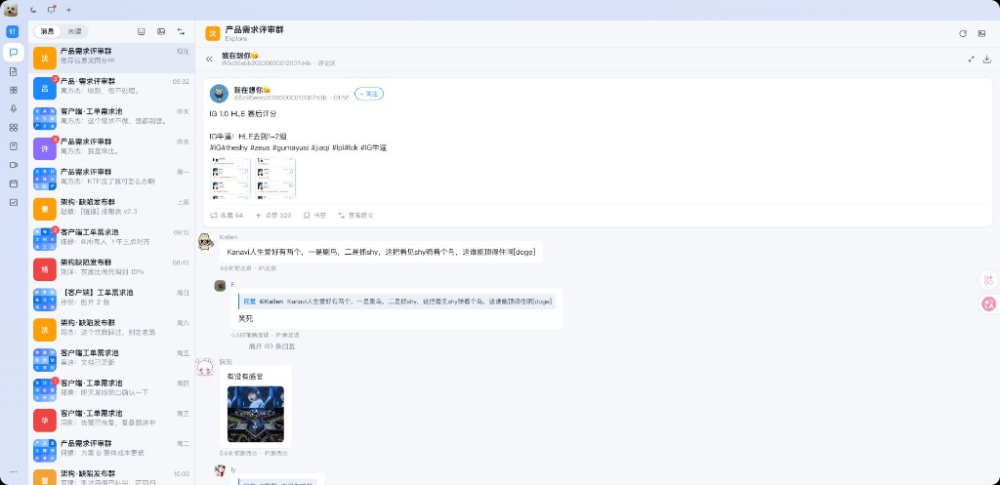
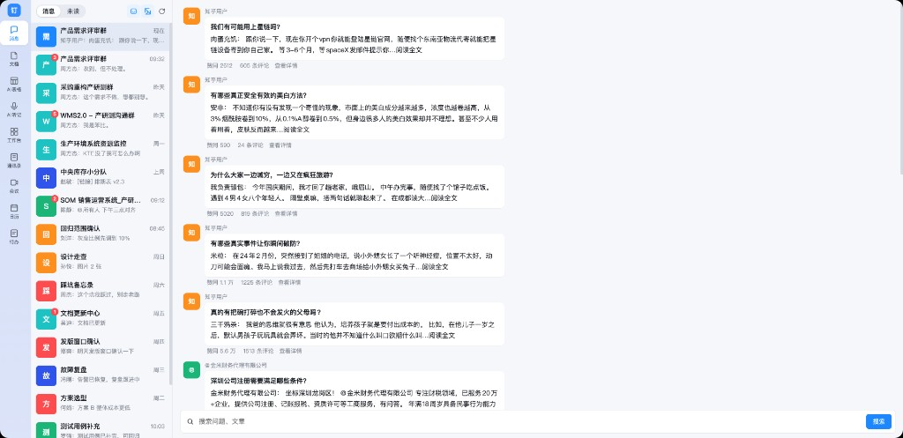

# 油猴脚本

个人用的 Tampermonkey（油猴）脚本。每个脚本只改网页外观，点赞、评论、关注仍走网站原来的按钮。

安装：浏览器装好 Tampermonkey 后，新建脚本，把对应文件全文贴进去并保存，再打开匹配的网站。

## 脚本一览

| 脚本 | 文件 | 作用 | 匹配网站 |
| --- | --- | --- | --- |
| 小红书 · IM 三合一样式 | [小红书/xhs-dingding.js](小红书/xhs-dingding.js) | 把小红书换成钉钉 / 飞书 / 企业微信三栏聊天壳。笔记列表和详情、评论收成会话；可切换皮肤、深浅色、纯文本摸鱼、百家姓脱敏。 | `xiaohongshu.com` |
| 知乎 · 钉钉样式 | [知乎/zhihu-dingding.js](知乎/zhihu-dingding.js) | 按钉钉三栏重绘知乎：左栏导航、中栏会话、右栏气泡。可一键隐藏图片。 | `zhihu.com`、`zhuanlan.zhihu.com` |

## 小红书 · IM 三合一样式

一套脚本三种 IM 皮肤（钉钉、飞书、企业微信）。中栏是笔记列表（推荐 / 搜索 / 频道），右栏把笔记详情和树状评论收成聊天抽屉。只换皮，不改小红书里的数据。

## 知乎 · 钉钉样式

用钉钉的三栏会话布局盖住知乎页面。赞同、评论、打开详情仍然点击知乎自己的按钮。右上角可以切换是否显示图片。

